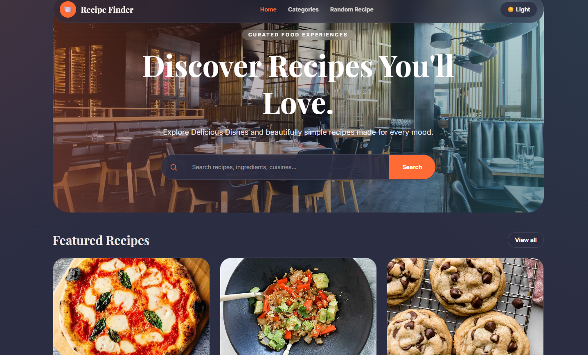
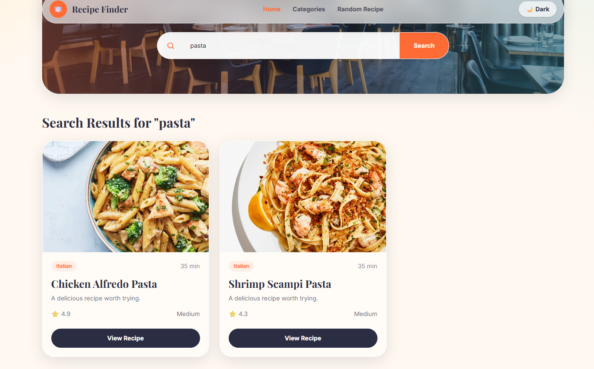
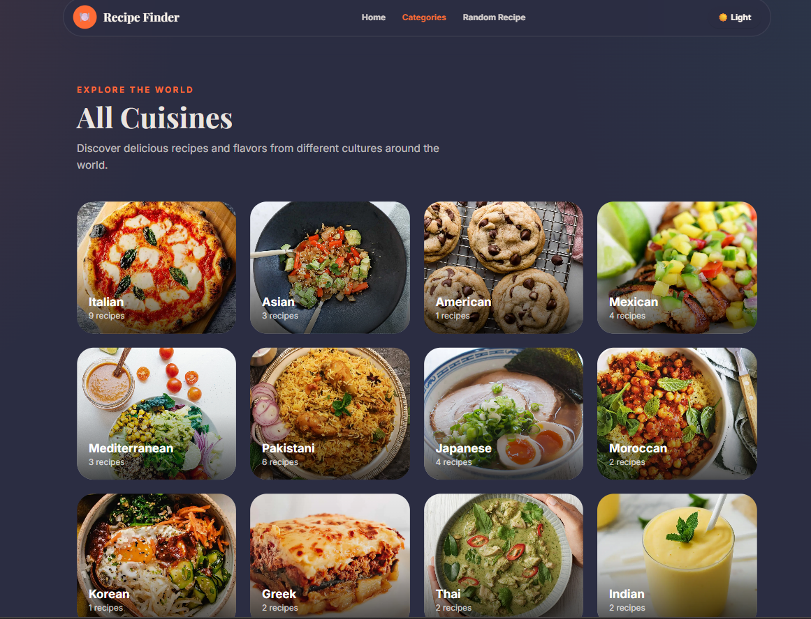
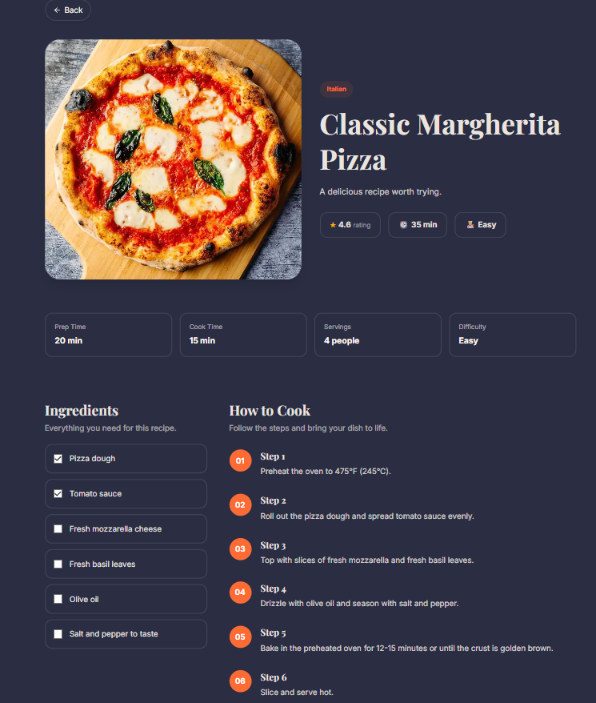

# 🍽️ Recipe Finder

> **Discover and explore recipes from around the world.** A beautifully crafted React application with dark mode support, real-time search, and smooth animations — built for food lovers by a food lover.


---

## ✨ Features

- 🔍 **Real-Time Recipe Search** — Search recipes by name, cuisine, or tags instantly
- 🌙 **Dark / Light Mode** — Toggle between themes with a smooth transition
- 📱 **Fully Responsive** — Beautiful on mobile, tablet, and desktop
- 🎨 **Glassmorphism UI** — Modern frosted-glass design with custom animations
- 📂 **Category Browsing** — Explore recipes by popular categories
- 🎲 **Random Recipe Generator** — Discover something new with one click
- 🔎 **404 Error Page** — Graceful handling for broken links
- ♿ **Accessible Navigation** — Clean semantic HTML and keyboard-friendly

---

## 🛠️ Tech Stack

| Technology | Role |
|-----------|------|
| **React 19** | Core UI library |
| **Vite** | Fast build tool and dev server |
| **Tailwind CSS 4** | Utility-first styling |
| **React Router** | Client-side routing |
| **DummyJSON API** | Free mock recipe database |
| **react-icons** | Beautiful icon library |

---

## 🚀 Getting Started

### Prerequisites
- [Node.js](https://nodejs.org/) (v18 or higher recommended)
- [npm](https://www.npmjs.com/) (comes with Node.js)

### 1. Clone the Repository
```bash
git clone https://github.com/Sel049/recipe-finder.git
cd recipe-finder
```

### 2. Install Dependencies
```bash
npm install
```

### 3. Start the Development Server
```bash
npm run dev
```
The app will open at **http://localhost:5173** in your browser.

### 4. Build for Production
```bash
npm run build
```

---

## 📂 Project Structure

```
recipe-finder/
├── public/
│   └── favicon.svg
├── src/
│   ├── components/          # Reusable UI components
│   │   ├── HeroSection.jsx      # Search bar & hero banner
│   │   ├── FeaturedRecipes.jsx  # Recipe card grid (searchable)
│   │   ├── RecipeCard.jsx       # Individual recipe card
│   │   ├── Catagories.jsx       # Popular categories grid
│   │   ├── ExploreCuisines.jsx  # Cuisine showcase section
│   │   ├── NavBar.jsx           # Navigation + theme toggle
│   │   └── Footer.jsx           # Site footer with links
│   ├── pages/
│   │   ├── HomePage.jsx         # Main landing page
│   │   ├── CategoriesPage.jsx   # Browse by cuisine
│   │   ├── RandomRecipe.jsx     # Random recipe generator
│   │   ├── RecipeDetails.jsx    # Full recipe view
│   │   └── NotFoundPage.jsx     # 404 error page
│   ├── layouts/
│   │   └── MainLayout.jsx       # Layout wrapper (Nav + Footer)
│   ├── App.jsx                  # Route definitions
│   ├── main.jsx                 # Entry point
│   └── index.css                # Global styles & Tailwind config
├── package.json
└── README.md
```

---

## 📸 Screenshots

> **How to Take Screenshots (Windows):** Press `Win + Shift + S` to open the Snipping Tool, select the area, and paste (`Ctrl + V`) into your README.

### 🏠 Home Page — Light Mode
> *The landing page with hero banner, search bar, categories, and featured recipes*


### 🌙 Home Page — Dark Mode
> *Click the moon icon in the navbar to toggle dark mode*


### 🔍 Search Results
> *Type a recipe name, cuisine, or tag and press Enter to see results*


### 📂 Categories Page
> *Browse recipes by cuisine type (Italian, Indian, Mexican, etc.)*


### 🍽️ Recipe Details
> *Click any recipe card to view full details*



---

## 🧭 Routing Guide

| Route | Page | Description |
|-------|------|-------------|
| `/` | HomePage | Landing page with search & featured recipes |
| `/categories` | CategoriesPage | Browse recipes by cuisine |
| `/randomrecipe` | RandomRecipe | Generate a random recipe |
| `/recipe/:id` | RecipeDetails | View full recipe by ID |
| `*` | NotFoundPage | 404 error page |

---

## 🎨 Design Philosophy

### Color Palette

| Color | Hex | Usage |
|-------|-----|-------|
| Cream | `#fff8f0` | Light background |
| Charcoal | `#2b2d42` | Text & dark backgrounds |
| Orange | `#ff6b35` | Primary accent (buttons, links) |
| Amber | `#ffd166` | Secondary accent (gradients, highlights) |
| Mint | `#2ec4b6` | Tertiary accent (gradients) |

### Typography
- **Playfair Display** — Used for all headings (elegant serif)
- **Inter** — Used for body text (clean sans-serif)

### Key Effects
- **Glassmorphism** — Frosted-glass cards with `backdrop-filter: blur()`
- **Shadow Glass** — Subtle depth: `0 10px 30px rgba(43, 45, 66, 0.12)`
- **Hover Animations** — `hover:scale-105`, `hover:shadow-lg` on interactive elements

---

## 📝 Available Scripts

| Command | Description |
|---------|-------------|
| `npm run dev` | Start development server |
| `npm run build` | Build for production |
| `npm run preview` | Preview the production build |
| `npm run lint` | Run ESLint |

---

## 🤝 Contributing

Contributions are what make the open source community amazing!

1. **Fork** the project
2. **Create** a feature branch (`git checkout -b feature/AmazingFeature`)
3. **Commit** your changes (`git commit -m 'Add some AmazingFeature'`)
4. **Push** to the branch (`git push origin feature/AmazingFeature`)
5. **Open** a Pull Request

---

## 📄 License

This project is licensed under the **MIT License**.

---

## 🙏 Acknowledgments

- [DummyJSON](https://dummyjson.com/) — Free mock API for recipe data
- [Unsplash](https://unsplash.com/) — Category images
- [Tailwind CSS](https://tailwindcss.com/) — Styling framework
- [React Icons](https://react-icons.github.io/react-icons/) — Icon library
- [Feather Icons](https://feathericons.com/) — Arrow icons

---

## 👤 Author

**Selman** — [GitHub Profile](https://github.com/Sel049)

---

> 💛 *"The best way to predict the future is to invent it." — Built with passion, one recipe at a time.*
